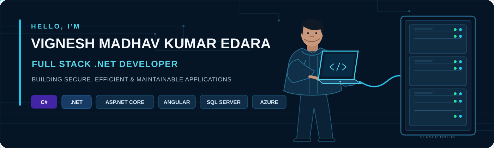
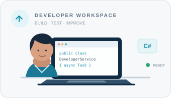

  

  
  
  

---

## About me

I'm **Vignesh Madhav Kumar Edara**, a **Full Stack .NET Developer** focused on building and improving business applications with **C#, ASP.NET Core, Entity Framework Core, SQL Server and Angular**.

I enjoy working across the application lifecycle — understanding a requirement, tracing an API request through the application layers, shaping data contracts, implementing business logic, persisting data and connecting the frontend to backend services.

My day-to-day engineering interests include:

- Building and extending REST APIs with ASP.NET Core.
- Structuring application logic across controllers, services and data-access layers.
- Working with EF Core, LINQ, SQL queries, stored procedures and relational data.
- Developing Angular interfaces with reusable components, routing and reactive forms.
- Integrating external services and handling request/response workflows, including XML-based integrations.
- Improving existing applications while keeping established behaviour and API contracts in mind.

I value code that is **readable, secure, efficient, testable and maintainable**. I prefer solving the actual problem with the simplest design that remains easy for another developer to understand and extend.

---

## Engineering approach

<table>
  <tr>
    <td width="50%" valign="top">
      <h3>Backend &amp; API development</h3>
      <ul>
        <li>Trace requests from controllers through services and repositories.</li>
        <li>Keep responsibilities clear and API contracts consistent.</li>
        <li>Validate inputs and handle expected failures predictably.</li>
        <li>Use dependency injection and asynchronous I/O where appropriate.</li>
      </ul>
    </td>
    <td width="50%" valign="top">
      <h3>Data &amp; persistence</h3>
      <ul>
        <li>Work with EF Core entities, DTOs, mappings and change tracking.</li>
        <li>Understand SQL queries, stored procedures and data relationships.</li>
        <li>Avoid unnecessary database calls and investigate query behaviour.</li>
        <li>Keep persistence changes aligned with application rules.</li>
      </ul>
    </td>
  </tr>
  <tr>
    <td width="50%" valign="top">
      <h3>Frontend integration</h3>
      <ul>
        <li>Build Angular components and route-based application flows.</li>
        <li>Use TypeScript, reactive forms and service-based API communication.</li>
        <li>Keep UI state and HTTP logic separated from presentation.</li>
        <li>Build responsive interfaces with reusable styling.</li>
      </ul>
    </td>
    <td width="50%" valign="top">
      <h3>Reliability &amp; maintainability</h3>
      <ul>
        <li>Consider backward compatibility when changing existing workflows.</li>
        <li>Use structured logging and useful error handling.</li>
        <li>Keep configuration environment-aware and secrets out of source code.</li>
        <li>Verify important success paths and failure scenarios.</li>
      </ul>
    </td>
  </tr>
</table>

---

## Technology stack

| Area | Technologies |
| :--- | :--- |
| **Languages** | C# · TypeScript · SQL |
| **Backend** | .NET · ASP.NET Core · REST APIs · Dependency Injection · LINQ · Async/Await |
| **Data access** | Entity Framework Core · SQL Server · Stored Procedures · DTOs &amp; Mapping |
| **Frontend** | Angular · Angular Material · RxJS · Reactive Forms · HTML · SCSS |
| **Cloud &amp; integrations** | Microsoft Azure · Azure Blob Storage · External API &amp; XML integrations |
| **Tools &amp; workflow** | Visual Studio · VS Code · Git · GitHub · GitHub Actions |

### Currently exploring

  
  
  

I'm learning how agent-based systems and MCP can connect applications, tools and contextual workflows. These are active learning areas, separate from the technologies I currently use in my core development work.

---

## Selected projects

<table>
  <tr>
    <td width="50%" valign="top">
      <h3><a href="https://github.com/VigneshMC-creator/portfolio">Vignesh.DEV — Developer Portfolio</a></h3>
      
A responsive Angular portfolio built with reusable standalone components and a consistent light/dark design system.

      <ul>
        <li>Angular standalone components and Router.</li>
        <li>Reactive contact form with a service layer and email fallback.</li>
        <li>Searchable skills matrix and interactive UI sections.</li>
        <li>Swagger-inspired API playground using an in-browser mock service for GET, POST, PUT and DELETE demonstrations.</li>
        <li>GitHub Actions deployment to GitHub Pages.</li>
      </ul>
      
Angular · TypeScript · RxJS · SCSS · GitHub Actions

      
<a href="https://vigneshmc-creator.github.io/portfolio/">Live portfolio ↗</a>

    </td>
    <td width="50%" valign="top">
      <h3><a href="https://github.com/VigneshMC-creator/Employee-Management">Employee Management</a></h3>
      
An Angular application focused on employee-management flows and authentication screens.

      <ul>
        <li>Angular 20 standalone application structure.</li>
        <li>Angular Material UI components.</li>
        <li>Reactive login and registration forms with validation.</li>
        <li>Authentication service using Angular HttpClient for login requests.</li>
      </ul>
      
Angular · TypeScript · Angular Material · Reactive Forms · HttpClient

      
<a href="https://github.com/VigneshMC-creator/Employee-Management">View source ↗</a>

    </td>
  </tr>
</table>

### Professional development work

In professional codebases, I work on extending backend workflows and integrating application layers. Examples of the technical work include API endpoint development, controller-to-service flow, DTO mapping, EF Core and SQL persistence, external service communication, XML request/response handling, logging and Azure Blob Storage integration. Source code and customer-specific implementation details are not public, so they are intentionally not reproduced here.

---

## GitHub activity

<table align="center" width="100%">
  <tr>
    <td align="center" valign="middle" width="38%">
      
    </td>
    <td align="center" valign="middle" width="62%">
      
    </td>
  </tr>
</table>

---

## Connect

I'm interested in .NET backend development, full-stack application development, API design, data access patterns and maintainable software architecture.

  
  &nbsp;
  

  

